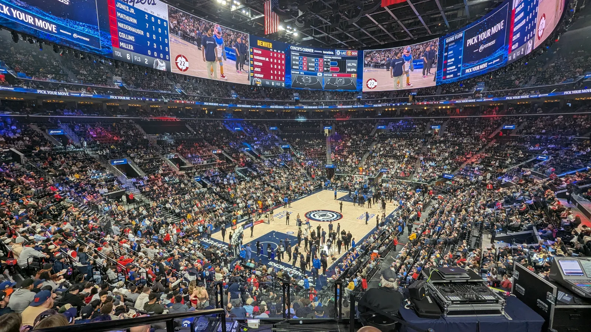

In February, I flew to **San Diego, USA** for the **[M3AAWG](https://www.m3aawg.org/) 66th General Meeting**, held February 16 to 19, 2026.

I gave a training session:

> :uk: **Breaking and Securing AI Agents Training: A Practical Exploration of Agent Exploits and Defenses**

AI agents read emails, browse the web and call tools on our behalf, which makes them a new target. The training walked attendees through how these agents can be manipulated, with hands-on exercises, then through the defenses that reduce the risk.

Thanks to everyone who attended and played along with the exercises!

I particularly enjoyed San Diego, so I took a few extra days to explore. I spent a day at the **San Diego Zoo**, and played a round at the **Morley Field Disc Golf Course** in Balboa Park. Then I went up to Los Angeles to tick off an old bucket-list wish: watching NBA games live. I saw two, one for the **Lakers** and one for the **Clippers**.

